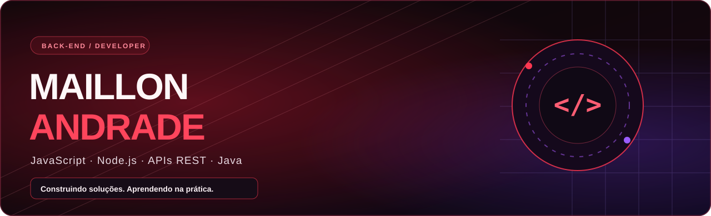
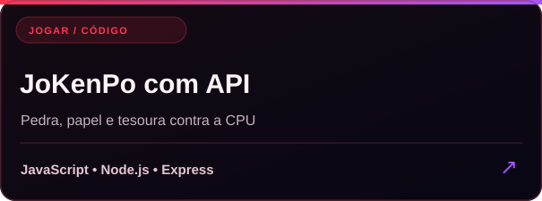
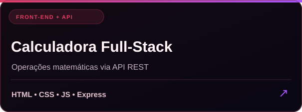
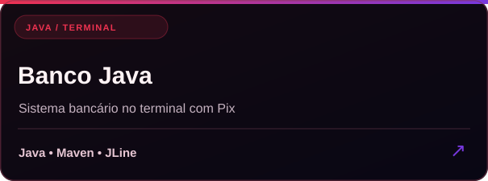
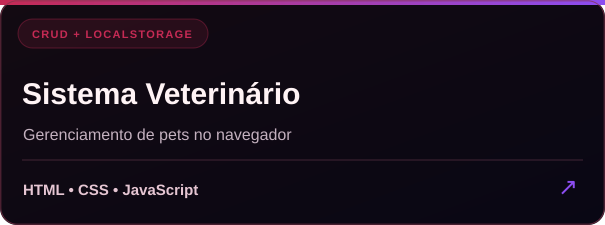

  

  <h2>Olá! Eu sou o Maillon 👋</h2>
  
<strong>Desenvolvedor back-end em formação</strong> · Estudante de Análise e Desenvolvimento de Sistemas (UNINTER)

  
Gosto de transformar ideias em projetos reais, principalmente com <strong>JavaScript, Node.js e APIs REST</strong>. Também venho estudando Java e boas práticas de desenvolvimento.

  

    
    
  

---

### ⚡ Sobre mim

- 🎓 **Formação:** cursando **Análise e Desenvolvimento de Sistemas** na UNINTER (EAD).
- 🛠️ **Foco principal:** desenvolvimento back-end, Node.js, Express, validação de requisições e APIs.
- 💡 **Como aprendo:** construindo sistemas práticos e entendendo o motivo de cada linha de código.
- 📚 **Em evolução:** Java, bancos de dados, arquitetura de APIs e autenticação.
- 🎯 **Objetivo:** conquistar minha primeira oportunidade profissional em desenvolvimento de software.

### 🧰 Tecnologias e ferramentas

  
  
  
  
  
  
  
  

### 🚀 Projetos em destaque

Projetos desenvolvidos por mim para praticar lógica, interfaces, comunicação com APIs e organização de código. Clique nos cartões para conhecer cada repositório:

<table>
  <tr>
    <td width="50%"></td>
    <td width="50%"></td>
  </tr>
  <tr>
    <td width="50%"></td>
    <td width="50%"></td>
  </tr>
</table>

  <a href="https://maillon49-prog.github.io/Jogo-de-JoKemPo-com-API/">🎮 Jogar JoKenPo</a>
  &nbsp;·&nbsp;
  <a href="https://maillon49-prog.github.io/calculadora-Com-API/">🧮 Testar calculadora</a>
  &nbsp;·&nbsp;
  <a href="https://github.com/maillon49-prog/Portifolio">🌐 Meu portfólio</a>

### 📍 Minha evolução

| Já pratico em projetos | Estudando e aprimorando |
| :-- | :-- |
| JavaScript e manipulação do DOM | Java e organização de aplicações |
| Node.js e criação de rotas com Express | Banco de dados e modelagem |
| Integração front-end/back-end com `fetch` | Autenticação e segurança |
| Validação de requisições e respostas HTTP | Arquitetura e boas práticas de APIs |

---

  
<strong>Construindo um projeto de cada vez.</strong>

  
🖤 Vermelho, preto e um toque de roxo — identidade visual do meu perfil.

  <a href="https://github.com/maillon49-prog?tab=repositories">Ver todos os meus repositórios →</a>

